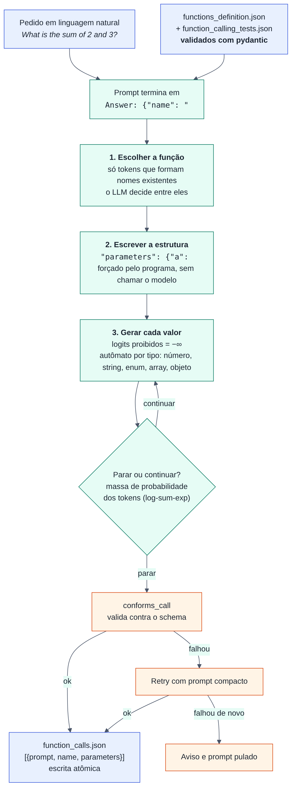

# call me maybe

Transforma um pedido em linguagem natural em uma **chamada de função estruturada**, usando um modelo pequeno (`Qwen/Qwen3-0.6B`) e **decodificação restrita**.

```text
"What is the sum of 2 and 3?"
        ↓
{"prompt": "...", "name": "fn_add_numbers", "parameters": {"a": 2.0, "b": 3.0}}
```

O programa **não responde** a pergunta. Ele escolhe qual função chamar e extrai os argumentos, com o JSON válido por construção.

## A ideia central

Pedir a um modelo de 0,6 bilhão de parâmetros que "responda em JSON" falha com frequência: ele esquece uma vírgula, inventa uma chave, escreve texto fora do JSON. Em vez de confiar no modelo, **controlo a decodificação**:

1. O **programa escreve a estrutura** (chaves, vírgulas, nomes dos parâmetros).
2. O **modelo só decide o conteúdo**: qual função, quais valores.
3. A cada decisão, os logits dos tokens que quebrariam o schema são descartados (equivalente a −∞) antes da escolha.

Resultado: a saída nunca é sintaticamente inválida, e o modelo só pode errar o *significado*.

## Fluxo do projeto



*Código-fonte do diagrama: [`docs/fluxo.mmd`](docs/fluxo.mmd) (Mermaid). Versão vetorial: [`docs/fluxo.svg`](docs/fluxo.svg).*

## Como usar

Requisitos: Python 3.10 ou superior e [uv](https://docs.astral.sh/uv/).

```bash
make install        # uv sync
make run            # data/input/*.json → data/output/function_calls.json
make test           # 68 testes, sem baixar o modelo
make lint           # flake8 + mypy
```

Opções úteis:

```bash
uv run python -m src --functions_definition F --input P --output O
uv run python -m src --trace                    # cada passo no terminal
uv run python -m src --trace-html trace.html    # visualização em HTML
uv run python -m src --use-sdk-tokenizer        # compara com o tokenizer da SDK
```

## Principais aprendizados

### 1. Um LLM só prevê o próximo token
O modelo devolve **logits**: uma pontuação para cada token do vocabulário (cerca de 150 mil). Toda a geração é um laço "calcular logits, escolher um token, acrescentar ao contexto". Entender isso torna a decodificação restrita simples: basta interferir na etapa "escolher".

### 2. Tokens não são caracteres
É a lição que mais pesou na prática. `",` costuma ser **um** token, e um emoji pode ser dividido em **vários** tokens de bytes. Por isso:
- cada token precisa de um *texto* para passar pelos autômatos, e fragmentos de UTF-8 ficam de fora das máscaras de string;
- o fechamento de aspas e chaves é **enfileirado** (`_pending`) e fundido ao próximo texto forçado, para que o contexto seja tokenizado como o modelo espera.

### 3. BPE byte-level, por dentro
Reimplementei o tokenizer a partir de `vocab.json` e `merges.txt`: normalização NFC, pré-tokenização por regex, mapeamento byte→caractere visível e fusão de pares pelo menor *rank*. Validei contra um tokenizer de referência (0 divergências em um vocabulário de teste) e deixei `--use-sdk-tokenizer` para comparar com o da SDK.

### 4. A gramática vira autômato
O número JSON e o conteúdo de uma string viram máquinas de estados pequenas (`automata.py`). Um token é permitido se, ao passar o texto dele pelo autômato, a máquina não morre. Isso cobre escapes (`\n`, `\"`, `\uXXXX`), negativos, decimais e expoente.

### 5. Parar ou continuar é uma decisão de probabilidade
Para saber quando um número ou uma string termina, comparo a **massa de probabilidade** (log-sum-exp) dos tokens que encerram contra a dos que continuam. Olhar só o melhor token individual erra, porque vários tokens de parada diferentes (`,`, `",`, `}`) dividem a probabilidade.

### 6. Quem escolhe a função é o modelo, não uma heurística
O nome é gerado token a token, restrito aos nomes que existem. A restrição define o que é *possível*; a escolha entre as possibilidades continua sendo dos logits do modelo.

### 7. Testar sem o modelo real
Criei um **LLM simulado** que "quer" uma resposta dada e devolve ruído no resto. Com ele, 68 testes rodam em menos de um segundo, sem baixar nada. O teste mais valioso é o do modelo que *quer lixo*: mesmo assim a saída continua válida.

### 8. Os testes acharam bugs reais
- Expoentes sem limite geravam `1e590191773951426287576`, que vira infinito em `float`. Corrigi na **gramática** (expoente de no máximo 2 dígitos) e não com um `try/except`.
- Arrays vazios eram impossíveis de gerar. Agora o modelo decide `]` logo após `[`.

### 9. Engenharia além do algoritmo
Escrita atômica da saída, erros tratados por camada (hierarquia `CallMeMaybeError`), retry com prompt compacto, cache LRU de logits (a SDK não tem KV-cache) e `mypy --strict` limpo.

## Decisões de design

| Decisão | Alternativa descartada | Motivo |
|---|---|---|
| Restringir a decodificação | Prompt + `json.loads` + retry | Validade garantida, não probabilística |
| Programa escreve a estrutura | Modelo gera o JSON inteiro | Menos chamadas ao modelo e chaves sempre corretas |
| Tokenizer próprio | `encode`/`decode` da SDK | Bônus, e o decoder precisa do texto de cada token |
| Cache LRU de logits | Sem cache | A SDK reprocessa o contexto inteiro a cada chamada |
| Máscaras numpy pré-computadas | Varrer o vocabulário a cada passo | Muito menos trabalho por passo |
| pydantic nas classes | Classes comuns | Exigência do subject e validação na entrada |

## Estrutura

```text
src/
├── cli.py            argparse, orquestração e códigos de saída
├── engine.py         prompt → chamada de função, com retry
├── decoder.py        decodificação restrita (o núcleo)
├── automata.py       autômatos de número e string JSON
├── tokenizer.py      BPE byte-level próprio
├── vocab.py          índice do vocabulário e máscaras numpy
├── model_client.py   cache LRU de logits
├── prompt.py         construção do prompt
├── models.py         modelos pydantic e validação por schema
├── io_utils.py       leitura/validação/escrita atômica
├── trace.py          visualização da geração
└── errors.py         hierarquia de exceções
tests/                68 testes com modelo simulado
docs/                 diagrama do fluxo
```

## Limitações e próximos passos

- A escolha dentro do conjunto permitido é gulosa (sem *sampling* nem *beam search*); a qualidade depende do modelo e do prompt.
- O programa **sempre** escolhe uma função, mesmo que o pedido não combine com nenhuma.
- Números têm no máximo 24 tokens e expoente de 2 dígitos.
- Não há suporte a `oneOf`/`anyOf`.
- Próximos passos: *beam search* restrito, medir o efeito de cada exemplo do prompt e permitir a resposta "nenhuma função".
